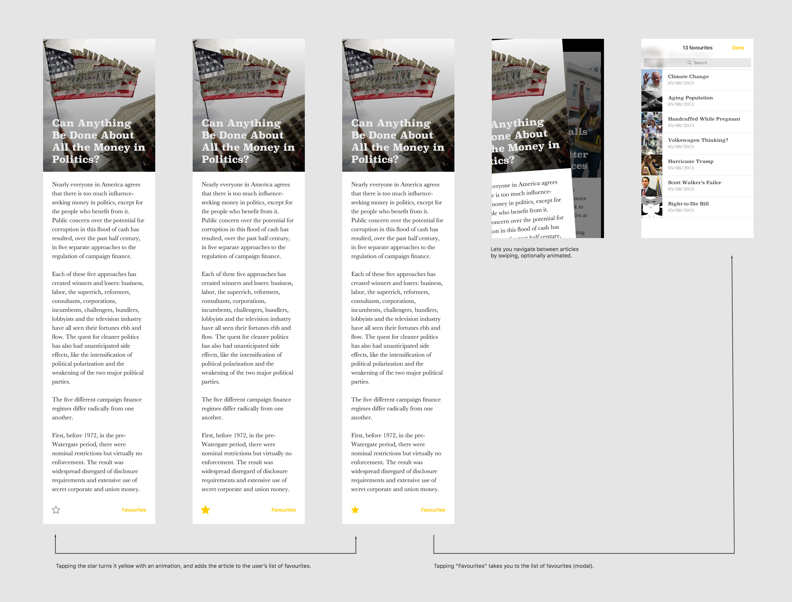

# Monzo Code Test for iOS Engineers



## Instructions

A developer at your company has been working on an app called "Headlines". The app uses the Guardian's news API to fetch headlines and display them to the user. Users can favourite articles that they like.

You've inherited their unfinished project, and a [design mockup](spec.png). It looks like the project might have some bugs, and the user interface definitely needs some work.

Your job, as the sole developer, is to add the missing features shown in the enclosed specification, fixing any bugs you might come across and prioritising as you see fit. Feel free to re-work any aspect of the codebase you're not happy with, within the bounds of the original spec.

**Treat this like an app that you are going to ship at the end of this exercise.**

You should spend no more than 4 hours on the project. We know this isn't anywhere near enough time to complete the spec, so no pressure to build all the features or fix all the bugs! 
 
We're interested to see the decisions you make along the way. Please include a short note with your response, explaining:
- what were your priorities, and why?
- if you had another two days, what would you have tackled next?
- what would you change about the structure of the code?
- what bugs did you find but not fix?
- what would you change about the visual design of the app?
- Approximately how long you spent on this project.

We'd love it if you could try and get this back to us within a week, but please let us know if you need longer, so we don't check-in with you too early 😊
Make a zip of your solution and upload it to the link in the email inviting you to this repository.

### Guardian API Key

Note that you might need to replace the Guardian API key for this project if [this link](https://content.guardianapis.com/search?api-key=09658731-cb6d-4a84-9e3c-5f030389de4e) doesn't work. To get a new key, go to https://bonobo.capi.gutools.co.uk/register/developer and register yourself as a developer. Once you get your key, replace the existing one in `Article.swift` with your own and you should be good to go!

--- 

# Summary

## How to Run
1. API key
- Copy `Headlines/Config/Secrets.xcconfig.example` -> `Headlines/Config/Secrets.xcconfig`
- Paste your Guardian key (get one at https://bonobo.capi.gutools.co.uk/register/developer)
```
GUARDIAN_API_KEY = YOUR-KEY-HERE
```
2. Open & Run
- Open the project in Xcode and run on a simulator/device.
- Info.plist uses $(GUARDIAN_API_KEY) so the app reads the key at runtime.
- Only the example file is committed; the real Secrets.xcconfig is git-ignored.

## Architecture
### Layers
- Presentation: View controllers + view models (UI logic only)
- Domain: Entities, mappers, use cases (app rules)
- Data: Repositories, API client, Realm models

## Environment
- Xcode 16.4, iOS 11.2+ target
- Network requests use HTTPS to the Guardian API
- No secrets in source control

## Key decisions made during the task
- Separate models for each layer:
- RemoteArticleDTO (network), ArticleDB (Realm), Article (domain/UI)
- ArticleDB uses:
```
@Persisted(primaryKey: true) var id: String
@Persisted var isFavourited: Bool = false
```
- Sync via partial upserts (update: .modified) that omit isFavourited so local favourites survive remote refreshes; remove stale rows with an IN filter.

## Trade-offs & Decisions (why)
- Restructure first (~2–2.5h) to go faster later.
  Cost: fewer features in 4h. Benefit: clearer seams, easy testing later, safer persistence changes.

- Upsert over delete-all.
  Keeps isFavourited intact on refresh and reduces churn. Considered separate favourites store (UserDefaults) but kept a single source of truth in Realm.

- Use @Persisted (modern Realm) over @objc dynamic.
  Pure Swift, inline primary keys/indexes, safer and faster.

- Keep deprecated Alamofire usage for now.
  Upgrading would take ~30 min with low user-visible impact; prioritised shipping core flows.

- Scope UI to core flows.
  Delivered readable article page, paging, favourites toggle & list. Deferred search, dark mode, typography polish, and error handling to stay within the 4h cap.

- Tests deferred.
  Designed for testability (VMs/repos, in-memory Realm) but chose user-visible features first. See “Next 2 days” for planned tests.
  
---

# What were your priorities, and why?
### Implemention in order of priority (≈ 4 hours):
- Secrets handled via Secrets.xcconfig (no keys in source control)
- Fetch & display Guardian headlines
- Horizontal paging between articles
- Project restructured into Domain / Data / Presentation with mappers & use cases 
- Favourites: toggle on article, persist to Realm, and view the favourites list
*Deferred:* some unit tests, integration tests, search, deeper UI polish, error handling

# If you had another two days, what would you have tackled next?
### If I Had Two More Days
1. Search on favourites (wire up the existing UISearchController)
2. Upgrade networking to latest Alamofire APIs (or move to URLSession + async/await)
3. Tests
    - ViewModel tests (favourite toggle, paging state)
    - Deferred Unit tests
    - Repository sync test (favourites survive refresh) using in-memory Realm
    - Snapshot tests for key screens
4. UX polish: dark mode, typography/spacing, empty/error state design, launch screen & app icon
5. Navigation from favourites into the article pager at the correct index
6. Packaging: extract Domain and Data into local SPM packages (faster builds, stricter access control)

# What would you change about the structure of the code?
- If I had more time, extract Domain and Data into local SPM packages (faster builds, stricter access control)
  
# What bugs did you find but not fix?  
### Known Issues / Polish
- Improve access control: Due to all layers being in a single module, interal access control exposes data layer to presentation layer. Needs fixing.
- Favourites image preloading: in the favourites list, an image may not appear until that article is viewed in the pager (cache).
- Planned fix: prefetch images for favourite IDs on entry to the favourites screen.
- Visual polish: use fixed size images and trimming text in list, uses system colors/layouts; dark mode and spacing could be refined. Loading/empty/error states need to be added.
- Dependencies: Alamofire API usage should be modernised.
- Minor naming/typo clean-ups and file splits (extensions) left for a tidy-up pass.

# What would you change about the visual design of the app?
### Visual Design Notes
- Current layout is intentionally simple and readable.
- Next pass: dark mode, a denser “grid” feed (image + headline), and a cleaner detail screen with improved typography.

# Approximately how long you spent on this project?
## Time Spent
- ≈ 4 hours total
- ~2.5h: restructuring (layers, models, mappers, Realm)
- ~1–1.5h: paging, favourites (toggle + list), sync, polish


